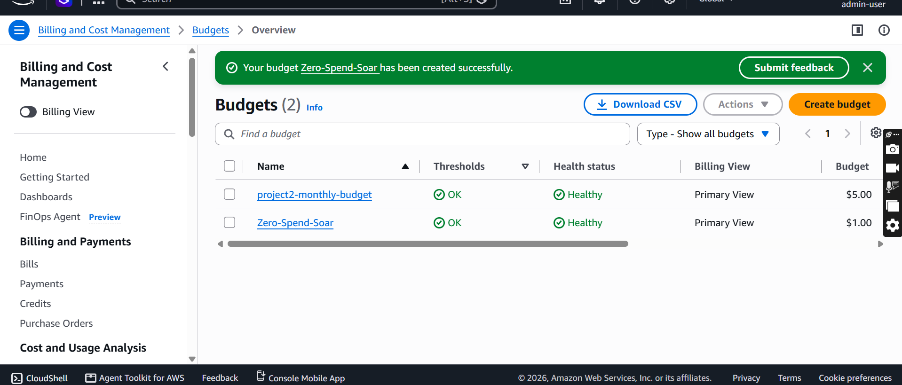
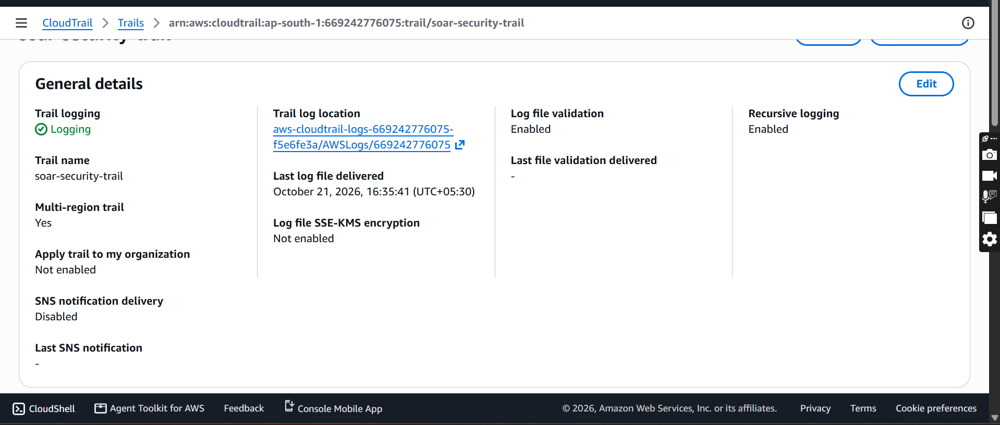
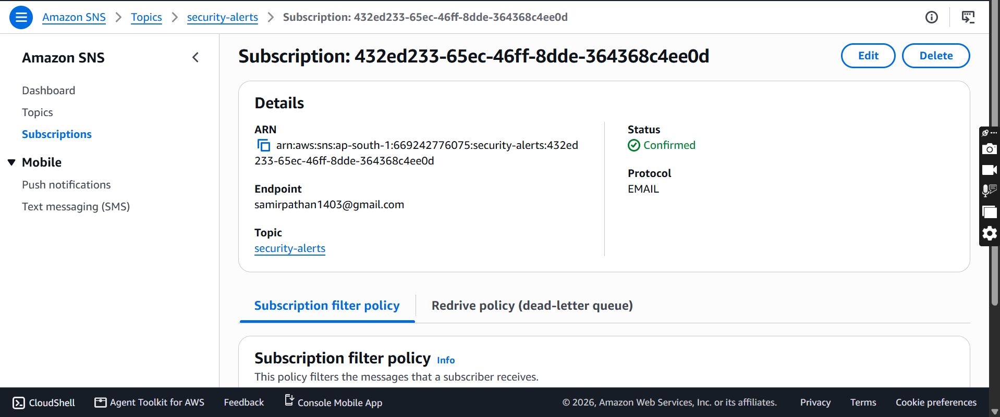

# AWS Automated Incident Response (SOAR)

An event-driven cloud security system on AWS that **detects risky changes in real time, fixes them automatically, and alerts the security team**.

> Status: 🚧 In progress. Sections marked ⏳ are filled in as each build step is completed.

---

## Problem

Most cloud breaches happen because of **misconfiguration**, not advanced hacking: a public S3 bucket, SSH open to the whole internet, or a root account login nobody noticed. Manual monitoring is slow. This project reduces **time to respond from hours to seconds**.

## What it does

| Threat | Detection | Automatic response |
|---|---|---|
| S3 bucket made public | CloudTrail event via EventBridge | Lambda re-enables Block Public Access |
| Security group opens port 22 to `0.0.0.0/0` | CloudTrail event via EventBridge | Lambda revokes the offending rule |
| Root account login | CloudTrail ConsoleLogin event | Instant alert (root should never be used) |

Every incident also sends an alert (email via SNS, Slack optional) with who, what, when, and what was fixed.

## Architecture

```
AWS Account activity
        │
   CloudTrail (audit logs)
        │
   EventBridge (rules match risky events)
        │
   Lambda (Python: auto-remediation)
        │
   SNS ──► Email / Slack alert
```

⏳ Architecture diagram: `architecture/diagram.md`

## Tech stack

AWS CloudTrail · Amazon EventBridge · AWS Lambda (Python, boto3) · Amazon SNS · AWS IAM (least privilege) · Amazon S3 · CloudWatch Logs

## Repository structure

```
aws-soar-incident-response/
├── README.md
├── architecture/          # diagrams
├── lambda/
│   ├── s3_remediation.py
│   ├── sg_remediation.py
│   └── root_login_alert.py
├── eventbridge/           # rule patterns (JSON)
├── docs/screenshots/
└── demo/                  # demo video / GIFs
```

## Setup steps

## Setup steps

1. ✅ **Foundation:** budget alert, CloudTrail (multi-region, management events), SNS topic `security-alerts`











2. ⏳ **S3 public bucket:** EventBridge rule + Lambda remediation

3. ⏳ **Open SSH port 22:** EventBridge rule + Lambda remediation

4. ⏳ **Root login alert**

5. ⏳ **Least-privilege IAM roles** for each Lambda

6. ⏳ **Testing and demo recording**

7. ⏳ **Terraform + Checkov + GitHub Actions**

## Demo

⏳ Demo video / GIF: make a bucket public, watch Lambda make it private again, receive the alert.

## Security design decisions

- **Least privilege:** each Lambda has its own IAM role with only the permissions it needs.
- **Detection and response are separated:** EventBridge detects, Lambda acts, SNS notifies.
- **Fail-safe alerts:** an alert is sent even if remediation fails.
- **Cost control:** built to run within AWS free tier, with a zero-spend budget alarm.

## Multi-cloud mapping

The concepts are cloud-agnostic. The same design maps directly to other providers:

| Capability | AWS (this project) | Google Cloud | Microsoft Azure |
|---|---|---|---|
| Audit logging | CloudTrail | Cloud Audit Logs | Activity Log |
| Event routing | EventBridge | Eventarc | Event Grid |
| Serverless response | Lambda | Cloud Functions | Azure Functions |
| Notifications | SNS | Pub/Sub | Action Groups |
| Block public storage | S3 Block Public Access | Public Access Prevention | Storage account public access setting |

## Possible future improvements

- Terraform for the whole stack, scanned with Checkov (prevention + detection + response)
- Automatic quarantine of compromised IAM keys
- Dashboard of incidents in CloudWatch
- Equivalent implementation on GCP or Azure

## What I learned

⏳ To be added after the build (challenges, mistakes, fixes).

## Author

**Samir Pathan**
GitHub: [SamirPathan8124](https://github.com/SamirPathan8124)
LinkedIn: [samir-pathan](https://www.linkedin.com/in/samir-pathan-218b84239)