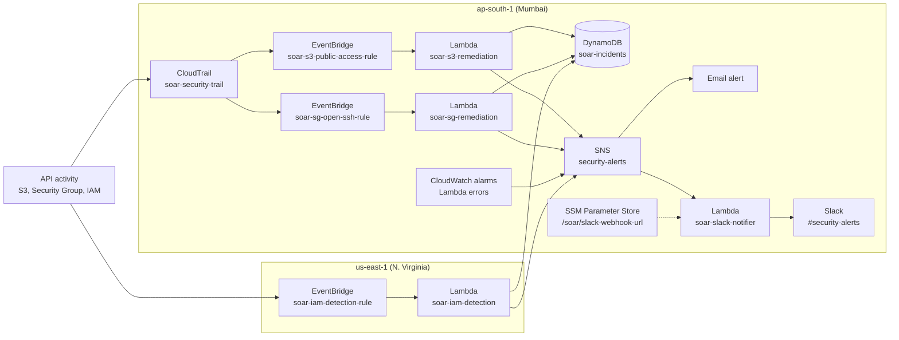

# AWS Automated Incident Response (SOAR)

Event-driven security automation on AWS. Risky changes in an account (a public S3 bucket, SSH open to the world, root or IAM key activity) are detected within seconds, fixed automatically where it is safe to do so, logged as incidents, and sent to email and Slack with a severity level.

Built as **Project 4** of my cloud portfolio, after the [AWS HA, DR and DevOps platform projects](https://github.com/SamirPathan8124/aws-ha-architecture-project).

## What it does

| Threat | Detection | Automatic response |
|---|---|---|
| S3 bucket made public | CloudTrail event, matched by an EventBridge rule | Lambda turns **Block Public Access** back on |
| Security group allows SSH (port 22) from `0.0.0.0/0` | `AuthorizeSecurityGroupIngress` event | Lambda **revokes the offending rule** |
| Root user activity or IAM access key creation | EventBridge rule in us-east-1 (IAM is a global service) | Lambda raises a **HIGH alert** for a human to review |

Every incident is written to a DynamoDB table (`soar-incidents`), published to an SNS topic (`security-alerts`), and forwarded to a Slack channel with a severity tag (HIGH, MEDIUM, LOW).

## Architecture



## AWS services used

CloudTrail, EventBridge, Lambda (Python), SNS, DynamoDB, SSM Parameter Store (SecureString), CloudWatch alarms, IAM, S3, EC2 security groups, AWS Budgets.

## Repository structure

```
.
├── architecture/diagram.md        # architecture diagram (Mermaid)
├── eventbridge/                   # EventBridge rule event patterns (JSON)
├── lambda/
│   ├── s3_remediation.py
│   ├── sg_remediation.py
│   ├── iam_detection.py
│   └── slack_notifier.py
├── docs/
│   ├── screenshots/               # proof of every phase
│   └── SCREENSHOTS.md             # screenshot gallery
└── README.md
```

## Build phases

| Phase | What was built |
|---|---|
| 0 | Repository setup |
| 1 | Budget alert, CloudTrail trail (`soar-security-trail`), SNS topic (`security-alerts`) |
| 2 | S3 public access auto-remediation (Lambda, IAM role, EventBridge rule), tested end to end |
| 3 | Security group open-SSH auto-remediation, tested end to end |
| 4 | DynamoDB incident log shared by the Lambdas, plus root and IAM access key detection in us-east-1 |
| 5 | Slack alerts with severity (webhook kept in SSM), CloudWatch alarms for Lambda failures, architecture diagram |
| 6 (planned) | Terraform for the whole stack, Checkov scan in CI |
| Planned | Python unit tests for the Lambda logic |

## How to test it

1. **S3:** in the test bucket, turn **Block all public access** off. Within seconds the setting is switched back on, an incident appears in DynamoDB, and an email and Slack alert arrive.
2. **Security group:** add an inbound SSH rule from `0.0.0.0/0` to the test security group. The rule is removed automatically and an alert is sent.
3. **IAM:** create an access key for a test user. A HIGH alert is raised.

Screenshots of each test are in [docs/SCREENSHOTS.md](docs/SCREENSHOTS.md).

## Security design

- One IAM role per Lambda, scoped to the actions it needs.
- The Slack webhook URL is stored as an SSM **SecureString** and read at runtime. No secrets are committed to this repository.
- Remediation is limited to changes that are safe to reverse automatically. Root and IAM events are only alerted, so a person decides what to do.
- Lambda failures raise CloudWatch alarms, so a silent remediation failure does not go unnoticed.

## Multi-cloud mapping (AWS to GCP and Azure)

The pattern is cloud-neutral: **audit log, event router, serverless function, notification topic, incident store, secret store**. Here is the same design on the other two clouds.

| Role in this project | AWS | Google Cloud | Azure |
|---|---|---|---|
| Audit trail | CloudTrail | Cloud Audit Logs | Azure Activity Log |
| Event routing | EventBridge | Eventarc | Event Grid |
| Serverless function | Lambda | Cloud Run functions | Azure Functions |
| Notification topic | SNS | Pub/Sub | Event Grid topic or Action Group |
| Incident store | DynamoDB | Firestore | Cosmos DB |
| Secret store | SSM Parameter Store | Secret Manager | Key Vault |
| Function identity | IAM role | Service account | Managed identity |
| Failure alerting | CloudWatch alarms | Cloud Monitoring alerts | Azure Monitor alerts |
| Public storage guardrail | S3 Block Public Access | Public access prevention | Disable blob public access |
| Network rule that was fixed | Security group | VPC firewall rule | Network security group |
| Native security hub | Security Hub, GuardDuty | Security Command Center | Defender for Cloud, Sentinel |

## Limitations and future work

- `soar-iam-detection` runs in us-east-1, and a CloudWatch alarm can only notify an SNS topic in its own region. That function therefore has no failure alarm yet. Fix: a second SNS topic in us-east-1, or cross-region event forwarding.
- The Slack notifier alarm notifies through the same SNS topic that feeds Slack, so if the notifier itself fails the alert arrives by email only.
- Severity is assigned by keyword matching. A structured severity field in each incident payload would be more reliable.
- Detection covers three scenarios. Natural extensions: unencrypted S3 buckets, public RDS snapshots, GuardDuty findings, and a human approval step before higher-risk fixes.
- Infrastructure is still created by hand. Phase 6 moves everything to Terraform with Checkov scanning in CI.

## Author

**Samir Pathan**
GitHub: [SamirPathan8124](https://github.com/SamirPathan8124)
LinkedIn: [samir-pathan](https://www.linkedin.com/in/samir-pathan-218b84239)