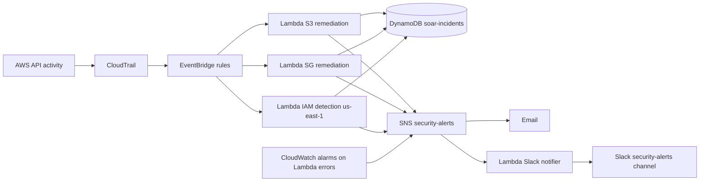
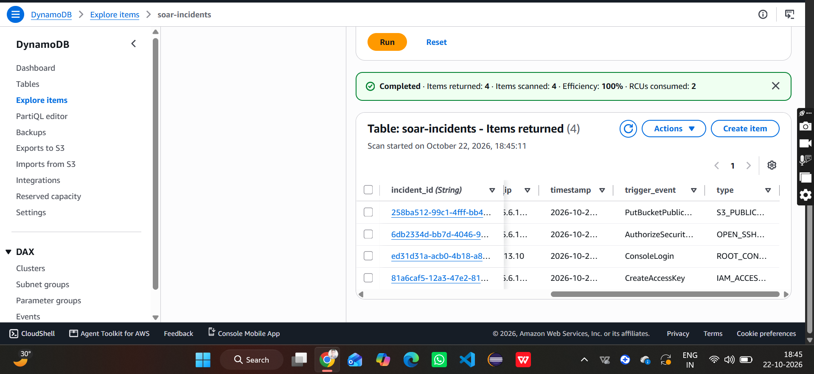
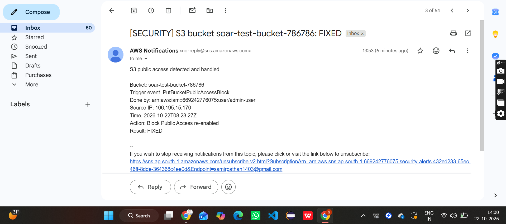
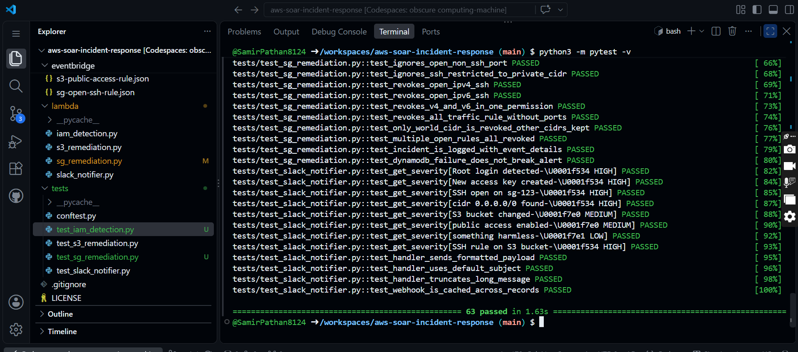
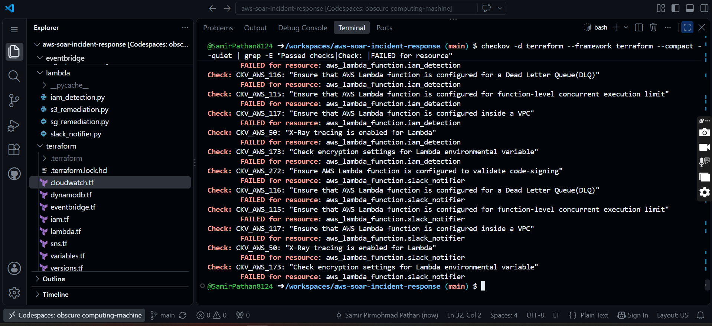

# AWS Automated Incident Response (SOAR)


A serverless security automation project on AWS. It detects risky changes in an AWS account, fixes the dangerous ones automatically, logs every incident, and alerts the team on Slack and email.

## What it does

| Detection | Trigger | Response |
|---|---|---|
| S3 bucket made public | `PutBucketPublicAccessBlock`, `DeleteBucketPublicAccessBlock`, `PutBucketPolicy`, `PutBucketAcl` | Re-enables Block Public Access, logs incident, sends alert |
| SSH open to the world on a security group | `AuthorizeSecurityGroupIngress` | Revokes the `0.0.0.0/0` and `::/0` rule for port 22, logs incident, sends alert |
| Root login, access key created, AdministratorAccess attached | `ConsoleLogin`, `CreateAccessKey`, `Attach*Policy` | Logs incident and sends alert (detection only) |

All alerts go to the SNS topic `security-alerts`, which fans out to email and to a Slack notifier Lambda that adds a severity label.

## Architecture



A detailed diagram is in [`architecture/diagram.md`](architecture/diagram.md).

## AWS services used

CloudTrail, EventBridge, Lambda, SNS, DynamoDB, Systems Manager Parameter Store, CloudWatch alarms, IAM, AWS Budgets. Infrastructure as code with Terraform, scanned with Checkov, tested with pytest, built in CI with GitHub Actions.

## Repository structure

```
aws-soar-incident-response/
├── lambda/                  # 4 Lambda functions (Python)
│   ├── s3_remediation.py
│   ├── sg_remediation.py
│   ├── iam_detection.py
│   └── slack_notifier.py
├── eventbridge/             # EventBridge rule patterns (JSON)
├── terraform/               # IaC (validate and scan only)
├── tests/                   # 63 pytest unit tests
├── architecture/diagram.md
├── docs/
│   ├── screenshots/
│   └── SCREENSHOTS.md       # screenshot gallery
├── .github/workflows/ci.yml
└── requirements-dev.txt
```

## How it works

1. **CloudTrail** (`soar-security-trail`) records API activity.
2. **EventBridge** rules match risky events and trigger a Lambda.
3. **Lambda** functions fix the problem (S3 and security group) or classify it (IAM), then write an incident record to DynamoDB and publish to SNS.
4. **SNS** (`security-alerts`) sends an email and invokes the **Slack notifier** Lambda, which reads the webhook URL from SSM Parameter Store (`/soar/slack-webhook-url`) and posts to `#security-alerts` with a severity of HIGH, MEDIUM or LOW.
5. **CloudWatch alarms** watch the Lambda `Errors` metric and alert through the same SNS topic, so a broken automation does not fail silently.

Region: everything runs in `ap-south-1`, except the IAM detection Lambda and its rule, which run in `us-east-1` because IAM and console sign-in events are global and are delivered there.

### Incident log

Every incident is stored in the DynamoDB table `soar-incidents` (partition key `incident_id`) with `timestamp`, `type`, `resource`, `severity`, `action`, `actor`, `source_ip` and `trigger_event`.





### Example: S3 auto-remediation





More screenshots of every phase are in [`docs/SCREENSHOTS.md`](docs/SCREENSHOTS.md).

## Design decisions

- **Loop guard**: the S3 fix itself creates a CloudTrail event. The Lambda checks whether the bucket is already fully blocked and stops, which prevents an endless trigger loop.
- **Logging never blocks the response**: if the DynamoDB write fails, the fix and the alert still go out.
- **Least privilege**: each Lambda has its own IAM role with only the actions it needs. Security group revoke is scoped to security-group ARNs (Describe has no resource-level support, so it stays `*`).
- **Secrets out of code**: the Slack webhook lives in SSM Parameter Store, not in environment variables or the repo.
- **Precise revoke**: only the world-open CIDR is removed from a rule, other CIDRs on the same rule are kept.
- **Observability**: failures raise CloudWatch alarms, and active X-Ray tracing is enabled in the Terraform code.

## Build phases

| Phase | What was built |
|---|---|
| 0 | Repository and Codespaces setup |
| 1 | AWS Budget, CloudTrail trail, SNS topic `security-alerts` |
| 2 | S3 public access auto-remediation (Lambda, IAM role, EventBridge rule) |
| 3 | Security group open SSH auto-remediation |
| 4 | DynamoDB incident log and IAM / root detection |
| 5 | Slack alerts with severity (SSM, notifier Lambda, SNS subscription), CloudWatch alarms |
| 6 | Unit tests, Terraform, Checkov and GitHub Actions CI |

## Testing

63 pytest unit tests cover all four Lambda functions. The AWS clients (S3, EC2, SNS, SSM, DynamoDB) are mocked, so the tests run without an AWS account or credentials.

| Test file | Tests | Covers |
|---|---|---|
| `test_s3_remediation.py` | 14 | Block Public Access check, loop guard, remediation, failure path, incident logging |
| `test_sg_remediation.py` | 17 | SSH rule detection (IPv4, IPv6, all-traffic), revoking only the world-open CIDR, incident logging |
| `test_iam_detection.py` | 20 | Root login, access key creation, AdministratorAccess attach, severity, ignored events |
| `test_slack_notifier.py` | 12 | Severity mapping, message truncation, webhook caching |

```bash
pip install -r requirements-dev.txt
python -m pytest -v
```





## Infrastructure as Code (Terraform)

The `terraform/` folder describes the whole system as code: SNS topic, DynamoDB table, four Lambda functions with IAM roles, EventBridge rules and CloudWatch error alarms. The IAM detection Lambda and its rule use a second provider alias for `us-east-1`.

This code is validated and security-scanned but **not applied**. The live resources were created manually in the console, and applying would conflict with them.

```bash
cd terraform
terraform init -backend=false
terraform validate
```

### Checkov findings

The first scan reported 117 passed and 27 failed checks. I fixed 6 and documented the other 21 as intentional skips, each with an inline `#checkov:skip` reason. The final scan has 0 failed checks.

| Finding | Action |
|---|---|
| IAM policy used `*` resource for security group revoke | Fixed: scoped to security-group ARNs |
| X-Ray tracing disabled (4 Lambdas) | Fixed: active tracing and X-Ray write policy |
| Code signing, VPC, DLQ, reserved concurrency, env var CMK (4 Lambdas each) | Skipped with reason: cost or overkill at this scale, listed in Future Work |
| DynamoDB customer-managed KMS key | Skipped with reason: AWS-managed encryption is on, a CMK adds cost and key policy overhead |





## CI

GitHub Actions (`.github/workflows/ci.yml`) runs on every push and pull request:

1. **Python unit tests**: pytest on Python 3.12
2. **Terraform validate**: `fmt -check`, `init -backend=false`, `validate`
3. **Checkov security scan**: fails the build on any unskipped finding

CI never deploys, so it needs no AWS credentials.


## Multi-cloud mapping

The same pattern (audit log, event routing, serverless function, notification, incident store) exists on every major cloud.

| Role in this project | AWS | Google Cloud | Azure |
|---|---|---|---|
| Audit log | CloudTrail | Cloud Audit Logs | Activity Log |
| Event routing | EventBridge | Eventarc (or log sink to Pub/Sub) | Event Grid |
| Serverless function | Lambda | Cloud Run functions | Azure Functions |
| Notification topic | SNS | Pub/Sub | Event Grid topics / Service Bus |
| Incident store | DynamoDB | Firestore | Cosmos DB |
| Secret / config store | SSM Parameter Store | Secret Manager | Key Vault |
| Metrics and alarms | CloudWatch alarms | Cloud Monitoring alerting | Azure Monitor alerts |
| Network rule remediated | Security group | VPC firewall rule | Network security group |
| Public storage guard | S3 Block Public Access | Public access prevention | Disable blob public access |
| Identity and access | IAM | Cloud IAM | Entra ID and Azure RBAC |
| Tracing | X-Ray | Cloud Trace | Application Insights |
| Infrastructure as code | Terraform | Terraform | Terraform |

Equivalent flow on Google Cloud: Cloud Audit Log, log sink, Pub/Sub, Cloud Run function (remediate), Firestore (incident log), Pub/Sub (alert). On Azure: Activity Log, Event Grid, Azure Function (remediate), Cosmos DB (incident log), Action Group (alert).

## Test resources

The demo used these throwaway resources: S3 bucket `soar-test-bucket-786786`, security group `soar-test-sg`, and IAM user `soar-test-user` with its access key. Remove them when you are done testing.

## Limitations and Future Work

- Terraform is validate-and-scan only; live resources were created manually and the code has not been applied or imported
- No CloudWatch alarm for the IAM detection Lambda (it runs in `us-east-1`)
- IAM and root events are detected and alerted, but not automatically remediated
- Dead letter queues, reserved concurrency, VPC placement, code signing and a customer-managed KMS key for DynamoDB were skipped in Checkov with documented reasons
- Single account and single region for the remediation Lambdas; a multi-account setup with AWS Organizations is a natural next step
- Add more detections (unencrypted S3 buckets, public RDS snapshots, IAM users without MFA)
- Store the Terraform state remotely and deploy through a gated pipeline

## Author

Samir Pathan

- GitHub: [SamirPathan8124](https://github.com/SamirPathan8124)
- LinkedIn: [samir-pathan](https://www.linkedin.com/in/samir-pathan-218b84239)